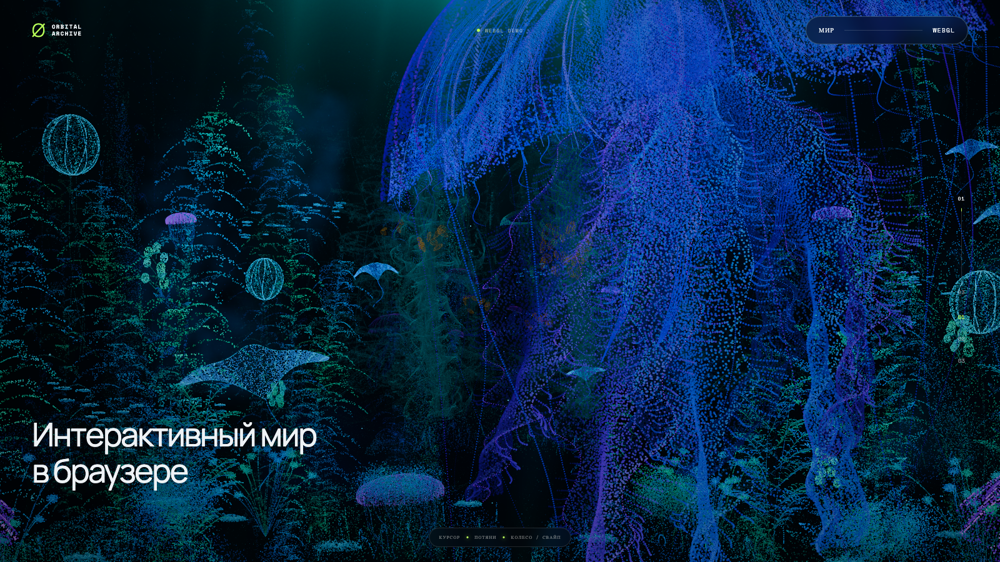
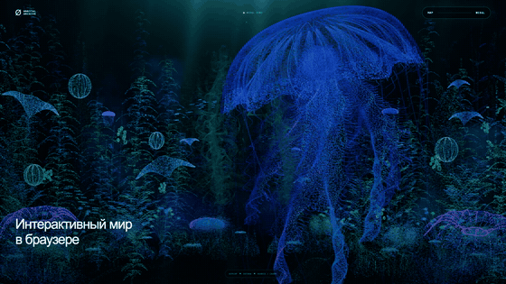
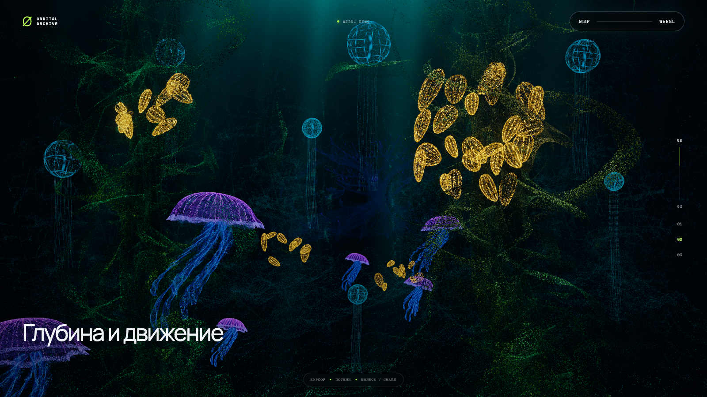
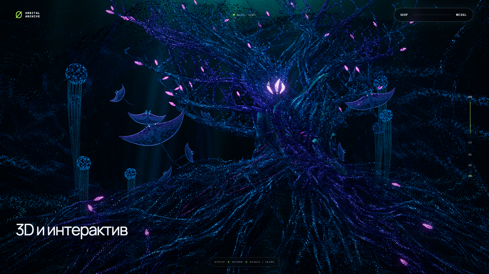

# Orbital Archive

Интерактивный подводный мир в браузере: светящиеся медузы, сад и дерево в глубине. Прокрутка ведёт камеру через единое 3D-пространство, а курсор и перетаскивание меняют ракурс.

Автор: [Марк / MDRK Studio](https://mdrkstudio.ru).



<picture>
  <source media="(prefers-reduced-motion: no-preference)" srcset="docs/demo.gif">
  
</picture>

## Внутри

- Three.js, JavaScript, Vite и GLSL.
- Процедурная геометрия и материалы, облака частиц и анимированные организмы.
- Непрерывный маршрут камеры и переходы между тремя сценами.
- Свечение, тональная компрессия и сглаживание через postprocessing.
- Настройки плотности и разрешения для небольших экранов.
- Учёт `prefers-reduced-motion`.

## Запуск

Нужны Node.js 22.12+ и npm.

```bash
npm ci
npm run dev
```

Открой адрес, который покажет Vite. Управление: колесо мыши или свайп для движения, перетаскивание для поворота. Кнопки `01`, `02`, `03` справа ведут к отдельным сценам.

## Сборка

```bash
npm run build
npm run preview
```

Результат появляется в `dist`. Это статический сайт, серверная часть и ключи API не нужны. Относительные пути позволяют разместить сборку в подпапке, например на GitHub Pages.

## Структура

```text
index.html           Разметка и навигация
src/main.js          Сцена, рендеринг и взаимодействие
src/flight-path.js   Маршрут камеры и переходы
src/scenes/          Геометрия, материалы и шейдеры
src/style.css        Интерфейс и адаптация
docs/                Скриншоты
```





## Зависимости и ограничения

Геометрия и текстуры создаются программно. Шрифты Manrope и Space Mono загружаются через Google Fonts; при недоступности сервиса используются системные шрифты. Three.js и его модули поставляются через npm.

Для сцены нужен браузер с WebGL 2 и аппаратным ускорением. Скорость зависит от GPU, разрешения экрана и браузера.. Уменьшение движения не отключает сам 3D-рендеринг.

[MDRK Studio](https://mdrkstudio.ru) · [Three.js](https://threejs.org) · [Vite](https://vite.dev)

## Лицензия

Авторский код - [PolyForm Noncommercial 1.0.0](LICENSE). Некоммерческое использование, изменения и распространение разрешены по её условиям. Сохраняйте LICENSE и [NOTICE](NOTICE).

Для коммерческого применения нужно разрешение [MDRK Studio](https://mdrkstudio.ru/contacts). Сторонние зависимости и ресурсы сохраняют собственные лицензии.
